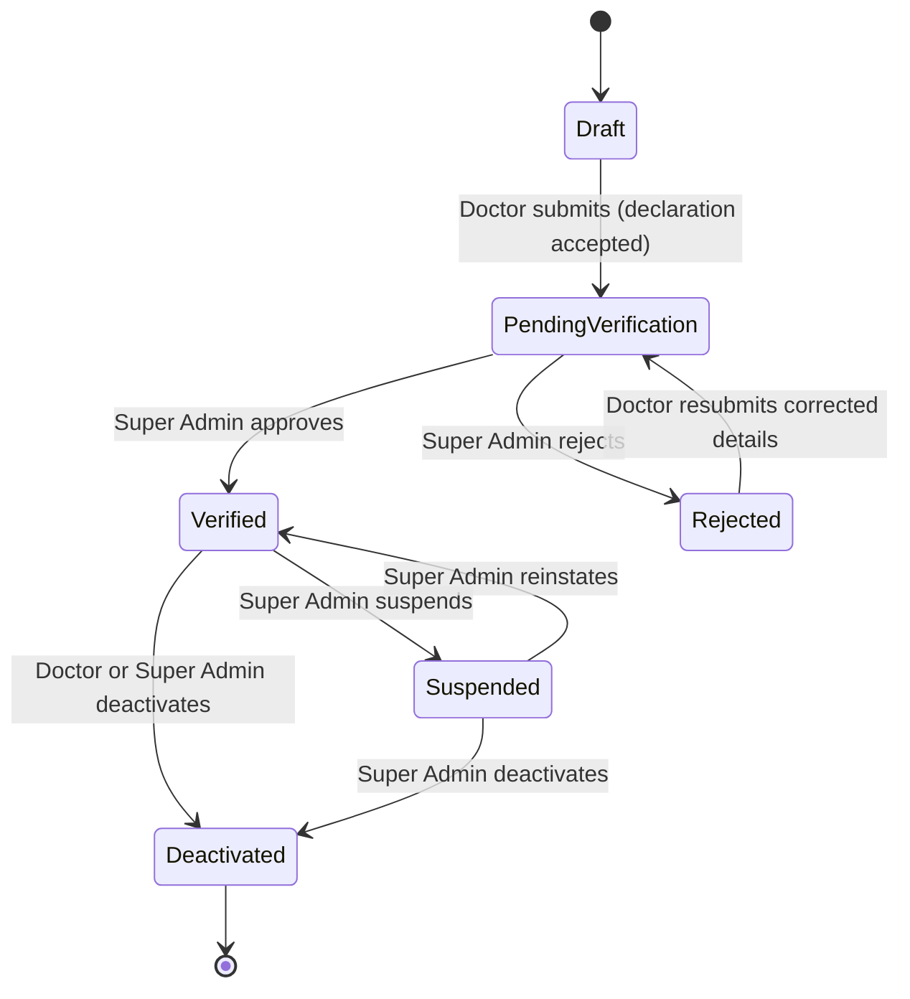
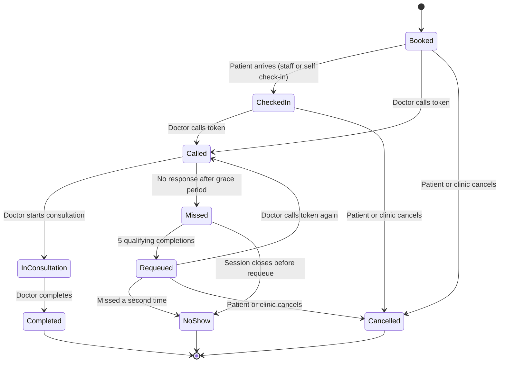
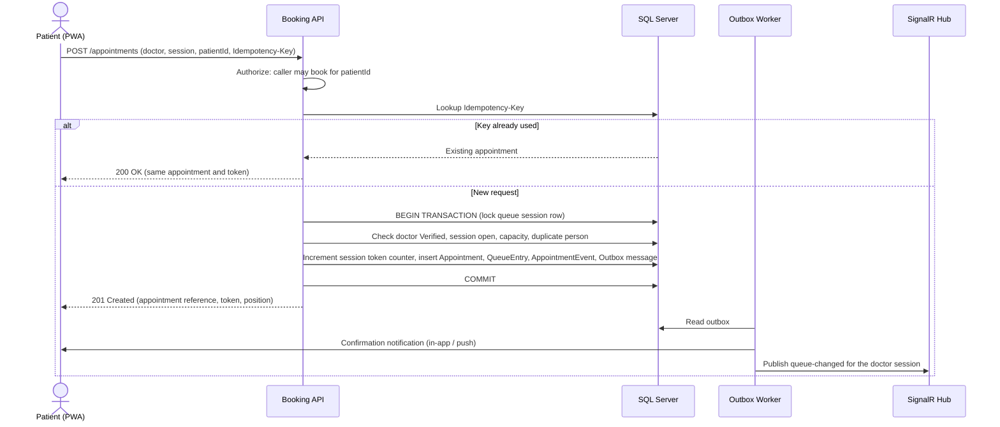
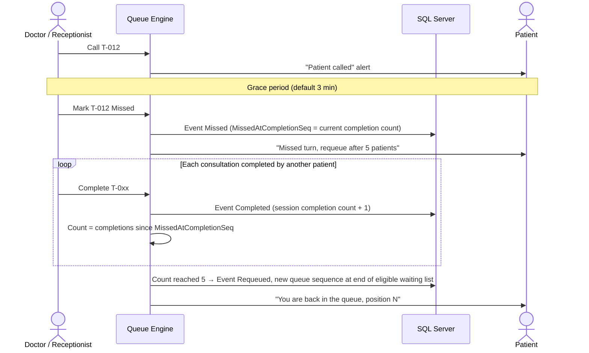
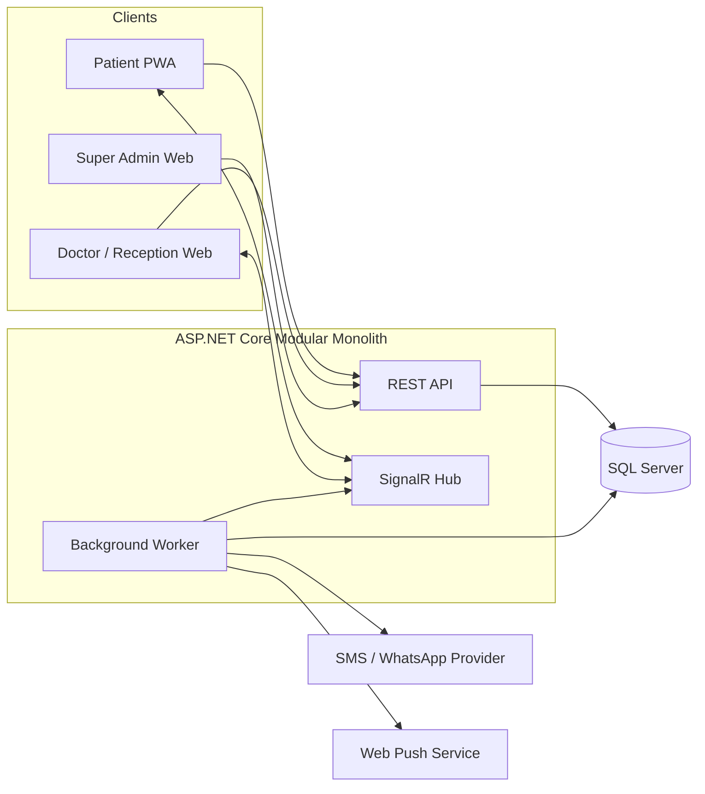

# Product Requirements Document (PRD)
# Smart Doctor Queue Management System

| Field | Value |
|---|---|
| **Version** | 1.3 |
| **Status** | Proposed — Ready for Product, Technical, and Legal Review |
| **Date** | 2026-10-13 |
| **Owner** | Pravin Dhote |
| **Product Type** | Multi-doctor, real-time queue management platform |
| **Initial Market** | India (pilot city: Nagpur) |
| **Platforms** | Mobile Web, Desktop Web, Progressive Web App (PWA) |
| **Primary Users** | Patients, Family Members, Doctors, Receptionists, Super Admins |

## Document Control

### Version History

| Version | Date | Author | Summary |
|---|---|---|---|
| 1.2 | — | Pravin Dhote | Complete functional draft: FR-01 to FR-19, data model, architecture, roadmap. |
| 1.3 | 2026-10-13 | Pravin Dhote | Review-ready refinement. Added success metrics, scope boundaries, assumptions, personas and user stories, state models, flow diagrams, business-rule defaults, compliance section, notification matrix, analytics events, phase exit criteria, open questions, and glossary. Clarified Super Admin access wording, Free-tier family limits, missed-turn edge cases, and durable job processing. No v1.2 requirement was removed and all requirement IDs are unchanged. |

### Reviewers and Approvers

| Role | Name | Review Status |
|---|---|---|
| Product Owner | _To be assigned_ | Pending |
| Engineering Lead | _To be assigned_ | Pending |
| UX Lead | _To be assigned_ | Pending |
| Legal / Privacy Counsel | _To be assigned_ | Pending |
| Clinical Advisor (pilot doctor) | _To be assigned_ | Pending |

### How to Read This Document

- **Part A** explains why the product exists, who it serves, and how success is measured.
- **Part B** contains the functional requirements. Requirement IDs (`FR-01` to `FR-19`) are stable across versions and should be referenced in tickets and tests.
- **Part C** defines state machines, key flows, and default business rules that remove ambiguity for engineering.
- **Part D** covers data, security, compliance, non-functional requirements, and architecture.
- **Part E** covers packaging, acceptance testing, release planning, risks, and open decisions.
- Priority labels: **P0** = required for MVP, **P1** = required before general availability, **P2** = future.

---

## Table of Contents

**Part A — Product Overview**
1. [Executive Summary](#1-executive-summary)
2. [Problem Statement](#2-problem-statement)
3. [Product Objectives](#3-product-objectives)
4. [Goals and Success Metrics](#4-goals-and-success-metrics)
5. [Scope](#5-scope)
6. [Assumptions and Dependencies](#6-assumptions-and-dependencies)
7. [User Roles](#7-user-roles)
8. [Personas and User Stories](#8-personas-and-user-stories)

**Part B — Functional Requirements**

9. [Doctor Registration and Medical ID (FR-01)](#9-doctor-registration-and-medical-id-fr-01)
10. [Unique Application Doctor ID (FR-02)](#10-unique-application-doctor-id-fr-02)
11. [Patient Registration (FR-03)](#11-patient-registration-fr-03)
12. [Family Member Management (FR-04)](#12-family-member-management-fr-04)
13. [Appointment Booking for Self or Family (FR-05)](#13-appointment-booking-for-self-or-family-fr-05)
14. [Doctor Discovery and Search (FR-06)](#14-doctor-discovery-and-search-fr-06)
15. [Public Doctor Profile (FR-07)](#15-public-doctor-profile-fr-07)
16. [Clinic Schedule and Availability (FR-08)](#16-clinic-schedule-and-availability-fr-08)
17. [Queue Booking and Token Generation (FR-09)](#17-queue-booking-and-token-generation-fr-09)
18. [Live Queue Position and Waiting Time (FR-10)](#18-live-queue-position-and-waiting-time-fr-10)
19. [Real-Time Updates and Notifications (FR-11)](#19-real-time-updates-and-notifications-fr-11)
20. [Doctor Queue Dashboard (FR-12)](#20-doctor-queue-dashboard-fr-12)
21. [Walk-In Patient Registration (FR-13)](#21-walk-in-patient-registration-fr-13)
22. [Emergency Queue Priority (FR-14)](#22-emergency-queue-priority-fr-14)
23. [Missed Turn and Five-Patient Requeue (FR-15)](#23-missed-turn-and-five-patient-requeue-fr-15)
24. [Out-of-Clinic, Holiday, and Closure Banners (FR-16)](#24-out-of-clinic-holiday-and-closure-banners-fr-16)
25. [Patient Visit History (FR-17)](#25-patient-visit-history-fr-17)
26. [Doctor Historical Records (FR-18)](#26-doctor-historical-records-fr-18)
27. [Super Admin Dashboard (FR-19)](#27-super-admin-dashboard-fr-19)
28. [Role-Permission Matrix](#28-role-permission-matrix)

**Part C — State Models and Business Rules**

29. [State Models](#29-state-models)
30. [Key Flows](#30-key-flows)
31. [Business Rules and Defaults](#31-business-rules-and-defaults)

**Part D — Data, Security, and Technology**

32. [Database Design](#32-database-design)
33. [Security and Privacy Requirements](#33-security-and-privacy-requirements)
34. [Regulatory and Compliance Considerations](#34-regulatory-and-compliance-considerations)
35. [Non-Functional Requirements](#35-non-functional-requirements)
36. [Recommended Technical Architecture](#36-recommended-technical-architecture)
37. [API Capability Requirements](#37-api-capability-requirements)
38. [Analytics and Product Events](#38-analytics-and-product-events)

**Part E — Packaging, Delivery, and Governance**

39. [Free, Pro, and Premium Packaging](#39-free-pro-and-premium-packaging)
40. [MVP Acceptance Test Scenarios](#40-mvp-acceptance-test-scenarios)
41. [Release Plan](#41-release-plan)
42. [Key Risks and Mitigations](#42-key-risks-and-mitigations)
43. [Open Questions and Decisions Log](#43-open-questions-and-decisions-log)
44. [Definition of Done](#44-definition-of-done)
45. [Glossary](#45-glossary)

---

# Part A — Product Overview

## 1. Executive Summary

### 1.1 Product Vision

Build one centralized application through which patients can find doctors, book queue appointments, monitor their position in real time, and receive notifications when their turn approaches.

Doctors can register using their basic professional details and medical registration information, configure their clinic schedules, manage queues, add walk-in patients, prioritize emergency cases, and publish out-of-clinic or holiday announcements.

Patients can create a basic account and book appointments for themselves or family members, including their son, daughter, or spouse. Each appointment must clearly identify the person who will visit the doctor, even when another family member books it.

The platform will support multiple doctors using the same application while maintaining secure separation between their clinics, queues, and patient information.

Authorized Super Admin users can manage doctors and patients and access platform-wide appointment and visit history under controlled, audited administrative permissions.

### 1.2 Core Product Principles

1. One shared application for all doctors.
2. Every approved doctor receives a unique, permanent application Doctor ID.
3. Doctors provide their Medical Registration ID and accept a mandatory declaration before submitting their registration.
4. Patients can register with basic details and book for themselves or authorized family members.
5. Every appointment identifies both the booking account and the person visiting the clinic.
6. Patients can view their own authorized visit history and track their live queue position.
7. Doctors can control their own queues, including walk-ins, emergency priority, and missed-turn requeue.
8. Queue updates and appointment changes are communicated in real time where supported.
9. Private patient history must not be accessible to unrelated doctors or patients.
10. Super Admin users can access platform-wide records only through role-based permissions, for a legitimate platform purpose, with every access audited (see [§27](#27-super-admin-dashboard-fr-19) and [§28](#28-role-permission-matrix)).

## 2. Problem Statement

Traditional clinic queue management often relies on paper tokens, phone calls, handwritten registers, and manual announcements.

These methods create several problems:

- Patients cannot easily check their queue position.
- Patients waste time waiting at clinics.
- Reception staff repeatedly answer calls about waiting times.
- Doctors must accommodate walk-ins and urgent patients manually.
- Missed turns disrupt queue order.
- Clinic timing changes may not reach affected patients.
- Parents and family members need to book appointments for other people.
- A family member booking an appointment can create confusion about whose name should be on the booking.
- Doctors need a simple way to manage daily and historical queues.
- The platform must prevent unauthorized access to patient history across doctors and clinics.

The proposed system provides a digital queue, family-aware appointment booking, automated notifications, schedule management, and secure patient and doctor histories.

## 3. Product Objectives

### 3.1 Patient Objectives

- Register with basic personal details.
- Search for doctors by name or Doctor ID.
- Book an appointment for themselves or an authorized family member.
- Receive a queue token.
- View current queue position and estimated waiting time.
- Receive turn-approaching and turn-called notifications.
- View their own visit history and the permitted history of family members they manage.
- See whether a doctor is available, on leave, or operating on modified hours.

### 3.2 Doctor Objectives

- Register with basic professional details and Medical Registration ID.
- Accept the medical ID declaration and applicable terms.
- Receive a unique application Doctor ID.
- Configure clinic hours and queue capacity.
- Manage appointments, walk-ins, emergencies, and missed turns.
- View today's patients and historical appointments.
- Notify affected patients about delays, holidays, and schedule changes.

### 3.3 Platform Objectives

- Support multiple doctors and clinics on a single platform.
- Maintain reliable queue and appointment data.
- Prevent unauthorized data access.
- Provide controlled Super Admin access to platform-wide history.
- Keep the architecture ready for future expansion to multi-branch clinics, subscriptions, and native apps.

## 4. Goals and Success Metrics

Targets below apply to the pilot (first 90 days after pilot launch) unless stated otherwise. Baselines for clinic waiting time are collected during the first two pilot weeks through receptionist observation or a short patient survey.

### 4.1 North-Star Metric

**Completed consultations served through the digital queue per week.** It grows only when doctors run real sessions on the platform and patients actually attend.

### 4.2 Outcome Metrics

| Goal | Metric | Pilot Target |
|---|---|---|
| Less time wasted at the clinic | Median time between patient check-in and being called, compared with baseline | 30% reduction |
| Fewer phone calls to reception | Receptionist-reported "where is my turn" calls per session | 50% reduction |
| Patients adopt self-service | Share of queue entries booked online (versus walk-in) | ≥ 40% by day 90 |
| Doctors adopt the product | Verified doctors running at least 3 sessions per week | ≥ 70% of onboarded pilot doctors |
| Patients come back | Patients with a second booking within 60 days | ≥ 35% |
| Satisfaction | Patient and doctor Net Promoter Score | ≥ +30 |

### 4.3 Quality and Guardrail Metrics

| Area | Metric | Target |
|---|---|---|
| Queue integrity | Duplicate active tokens in the same queue | 0 |
| Queue integrity | Requeue counter discrepancies found in audit | 0 |
| Booking reliability | Booking requests failing with a server error | < 0.5% |
| Notifications | Turn-approaching alerts delivered before the patient is called (in-app or push) | ≥ 95% |
| Performance | p95 queue-read latency | < 500 ms |
| Real-time | p95 time from queue change to connected client update | < 2 s |
| Privacy | Unauthorized-access incidents | 0 |
| Doctor onboarding | Median time from registration submission to verification decision | ≤ 2 business days |
| Estimate accuracy | Share of patients called within ±15 minutes of the estimate shown when 5 patients were ahead | ≥ 70% |

## 5. Scope

### 5.1 In Scope for MVP

Everything in [Part B](#part-b--functional-requirements): doctor registration and verification, Doctor ID generation, patient and family registration, doctor search and profiles, schedules and exceptions, serial-number token booking, live queue position and estimates, in-app and web push notifications, doctor dashboard, walk-ins, emergency priority, missed-turn requeue, announcements, patient and doctor history, Super Admin oversight, and audit logging.

### 5.2 Out of Scope for MVP

| Item | Notes |
|---|---|
| Online payments, consultation fees, refunds | Candidate for a later phase; requires payment-provider integration and compliance review. |
| Teleconsultation or video calls | Not planned. |
| Electronic medical records, prescriptions, diagnosis notes | The platform is a queue and appointment system, not an EMR. Only optional, minimal follow-up text is supported (FR-17). |
| Exact time-slot booking | MVP uses serial-number tokens; estimated times are approximate only. |
| Native Android and iOS apps | PWA first; native apps later. |
| Multi-branch organizations and hospital chains | Data model must not block this; product features are later (Premium tier). |
| Insurance, claims, and billing | Not planned. |
| ABDM (Ayushman Bharat Digital Mission) record linking, ABHA IDs | Future integration candidate; may also serve doctor verification (see [§34](#34-regulatory-and-compliance-considerations)). |
| Languages other than English | Hindi and Marathi are P1 for general availability; UI strings must be externalized from day one. |
| Automated medical triage | Explicitly excluded; the system never decides medical urgency (FR-14). |

## 6. Assumptions and Dependencies

### 6.1 Assumptions

- All clinics in the MVP operate in Indian Standard Time (IST). Times are stored in UTC and displayed in IST.
- Each doctor has one primary clinic during the pilot; the data model supports more.
- Patients have a smartphone with a modern browser, or are added as walk-ins by staff.
- A clinic runs one queue per doctor per session (for example, Morning and Evening).
- Receptionists use a desktop or tablet browser at the front desk.
- Mobile numbers can be shared within a family; one number may be linked to more than one account.

### 6.2 External Dependencies

| Dependency | Used For | Risk / Note |
|---|---|---|
| SMS gateway with OTP support | Patient and doctor login | Requires TRAI DLT registration of sender ID and templates before launch. |
| Web Push (VAPID) | Turn alerts | On iOS, web push works only for a PWA added to the home screen on iOS 16.4 or later. In-app status must work without push. |
| WhatsApp Business API provider (optional) | Notifications | Message templates need provider approval; per-message cost. |
| National Medical Register (NMC) and State Medical Council registers | Doctor verification | Automated lookup availability is not guaranteed; a manual review process is required as fallback. |
| Cloud hosting (Azure, Central India region preferred) | Hosting, database, backups | Data residency preferences to be confirmed by legal review. |

## 7. User Roles

### 7.1 Patient / Primary Account Holder

The primary account holder can:

- Register and sign in.
- Maintain their basic profile.
- Search for doctors.
- Book an appointment for themselves.
- Add authorized family-member profiles.
- Book appointments for eligible family members.
- View their own visit history.
- View permitted booking and history information for family members they manage.
- Track queue position and receive notifications.
- Cancel appointments according to clinic policy.

### 7.2 Family Member / Dependent

A family member is the person receiving the consultation.

Examples include:

- Son.
- Daughter.
- Wife or husband.
- Parent.
- Other authorized family member.

A family member may be represented through a dependent profile managed by the primary account holder or through their own account with an authorized family relationship.

The dependent does not need a separate login merely to be included in a booking, provided the clinic's registration rules are satisfied.

For adults, the product must provide an appropriate consent and account-linking mechanism so that booking on someone's behalf does not automatically grant unrestricted access to their private medical history.

### 7.3 Doctor

A doctor can:

- Register their professional profile.
- Submit their Medical Registration ID.
- Accept the required declaration.
- Complete any required verification process.
- Receive a permanent application Doctor ID.
- Configure their clinic.
- Manage their own queue.
- Add walk-ins and emergency patients.
- View authorized patient and appointment history.
- Publish announcements and schedule changes.

### 7.4 Receptionist / Authorized Clinic Staff

Authorized staff can:

- Add walk-in patients.
- Create appointments on behalf of patients.
- Identify the person who will visit.
- Check patients in.
- Manage permitted queue statuses.
- Send approved notifications.
- View records for their assigned doctor or clinic.

A doctor invites staff by mobile number; the staff role is scoped to that doctor and clinic and can be revoked at any time.

### 7.5 Super Admin

The Super Admin can:

- Manage doctor accounts and registration status.
- Review submitted Medical Registration IDs and verification results.
- Search patients and doctors.
- Access platform-wide patient appointment and visit history.
- Access doctor appointment and queue history.
- Monitor active queues and notification failures.
- Review audit events.
- Manage system configurations and account suspension.

Super Admin access must be restricted, authenticated, and auditable.

## 8. Personas and User Stories

### 8.1 Personas

| Persona | Role | Context | Main Need |
|---|---|---|---|
| **Rahul**, 38, Nagpur | Primary account holder | Books for self, spouse Priya, son Aarav (9), and daughter Ananya (6). Works in an office; cannot wait for hours at a clinic. | Know when to leave home so the child does not wait in a crowded clinic. |
| **Kamala**, 67, Chandrapur | Patient with limited smartphone use | Usually walks in; her adult son sometimes books for her. | Be served fairly without needing an app; keep her own history private unless she links her son. |
| **Dr. Amit Sharma**, General Physician | Doctor | Runs a single clinic with morning and evening sessions, 40–60 patients a day. | Run the queue with minimal taps, handle emergencies and missed turns without arguments. |
| **Sunita**, Receptionist | Clinic staff | Front desk; handles walk-ins, phone calls, and token slips. | Add walk-ins in under 30 seconds and stop answering "how long?" calls. |
| **Neha**, Platform Operations | Super Admin | Verifies doctors, handles support tickets. | Verify doctors quickly and investigate issues without breaching privacy. |

### 8.2 User Stories

| ID | As a… | I want to… | So that… | FR |
|---|---|---|---|---|
| US-01 | Doctor | Register with my Medical Registration ID and accept the declaration | I can be verified and start accepting bookings | FR-01 |
| US-02 | Doctor | Receive a short, permanent Doctor ID | Patients can find me reliably | FR-02 |
| US-03 | Patient | Register with my mobile number and an OTP | I can book without filling long forms | FR-03 |
| US-04 | Account holder | Add my children and spouse as family profiles | I can book for them without new accounts | FR-04 |
| US-05 | Account holder | Choose "Who is this appointment for?" while booking | The doctor sees the right patient's name | FR-05 |
| US-06 | Patient | Search by Doctor ID, name, city, or specialty | I can find the right doctor quickly | FR-06 |
| US-07 | Patient | See today's clinic status and queue on the doctor's profile | I know whether it is worth booking today | FR-07 |
| US-08 | Doctor | Set weekly hours, sessions, holidays, and capacity | Bookings only happen when I am available | FR-08 |
| US-09 | Patient | Receive a token immediately after booking | I have proof of my place in the queue | FR-09 |
| US-10 | Patient | See how many people are ahead and an estimated wait | I can arrive just in time | FR-10 |
| US-11 | Patient | Be alerted when three patients are ahead and when I am called | I do not miss my turn | FR-11 |
| US-12 | Doctor | Call next, complete, or mark missed with one tap each | The queue runs smoothly during a busy session | FR-12 |
| US-13 | Receptionist | Add a walk-in with name, relationship, and phone | Walk-ins join the same fair queue | FR-13 |
| US-14 | Doctor | Move a patient to the front with a reason | Urgent cases are seen first, with a record of why | FR-14 |
| US-15 | Patient | Be put back in the queue automatically after missing my turn | I am not forced to rebook | FR-15 |
| US-16 | Doctor | Publish a holiday or delay notice | Affected patients are informed automatically | FR-16 |
| US-17 | Account holder | See each family member's visits separately | Histories are never mixed | FR-17 |
| US-18 | Doctor | Search my past appointments by date, status, or token | I can answer patient queries and review workload | FR-18 |
| US-19 | Super Admin | Review pending doctor registrations and suspend bad actors | Only legitimate doctors accept patients | FR-19 |
| US-20 | Adult family member | Approve before another account can see my history | My medical visits stay private | FR-04, FR-17 |

---

# Part B — Functional Requirements

## 9. Doctor Registration and Medical ID (FR-01)

**Requirement ID:** FR-01  
**Priority:** P0 — Must Have

### 9.1 Doctor Registration Form

The doctor registration process must collect the following basic information.

**Personal and Contact Details**

- Full name.
- Mobile number (verified by OTP).
- Email address, where available.
- Primary clinic city (selected from the city registry; see FR-02).
- Basic address and clinic details.

**Professional Details**

- Medical Registration ID / professional registration number.
- Registering authority (National Medical Commission or the relevant State Medical Council), selected from a list.
- Specialty.
- Qualifications, as applicable.
- Primary clinic name.
- Clinic address.
- Working days and hours, which may be configured after registration.

Only the information necessary for account creation, doctor identification, and professional verification should be collected at registration.

### 9.2 Medical Registration ID

The Medical Registration ID is the professional registration identifier provided by the doctor. It is different from the application's Doctor ID.

| Field | Example |
|---|---|
| Doctor name | Dr. Amit Sharma |
| Medical Registration ID | As provided by the doctor |
| Registering authority | Maharashtra Medical Council |
| Application Doctor ID | `NGP-Dr-0001` |
| Primary city | Nagpur |
| Registration status | PendingVerification |

The Medical Registration ID must be stored separately from the application Doctor ID.

The system must not treat possession of a Medical Registration ID or acceptance of the declaration as proof that the doctor has been independently verified.

The same Medical Registration ID and authority combination may not be attached to more than one active doctor account. A duplicate submission is accepted for review but flagged to the Super Admin.

### 9.3 Mandatory Declaration and Consent

Before submitting the registration form, the doctor must accept a mandatory declaration.

**Checkbox label:**

> "I confirm that the Medical Registration ID and professional information provided by me are accurate and belong to me. I will not use another person's registration details, misrepresent my professional identity, or misuse another person's medical credentials. I understand that the platform may verify the information provided and may restrict or suspend my account if material information is false or misused."

The doctor must explicitly select this checkbox before registration submission. The checkbox must not be pre-selected.

The application must also provide links to the applicable platform terms, privacy notice, and professional verification policy.

The exact legal wording should be reviewed before production launch.

### 9.4 Declaration Acceptance Record

The system must record:

- Doctor account reference.
- Declaration version.
- Acceptance status.
- Acceptance timestamp.
- Relevant registration submission reference.
- Client IP address and user agent at acceptance (for evidential purposes, retained per the retention policy).

The system must not allow registration submission when the required declaration has not been accepted. This check is enforced on the backend, not only in the form.

If the declaration changes materially, the platform may require renewed acceptance according to its policy.

### 9.5 Medical ID Verification Workflow

Registration states (see the state diagram in [§29.1](#291-doctor-registration-states)):

1. `Draft` — registration has not been submitted.
2. `PendingVerification` — registration has been submitted and awaits review.
3. `Verified` — the required verification process has succeeded.
4. `Rejected` — verification has failed.
5. `Suspended` — access is restricted.
6. `Deactivated` — the account is no longer active.

The platform should use an official verification source or a documented administrative review process where available and appropriate.

Only doctors who meet the product's verification policy should be allowed to accept patient bookings. The exact verification method must be confirmed before launch (see [§43](#43-open-questions-and-decisions-log), OQ-01).

A rejected doctor receives the rejection reason category and may resubmit corrected details, which returns the account to `PendingVerification`.

### 9.6 Acceptance Criteria

- The Medical Registration ID is mandatory.
- The declaration checkbox is mandatory.
- Registration submission is blocked if required acceptance is missing.
- The declaration version and timestamp are recorded.
- The system distinguishes verified from unverified doctors.
- An invalid, rejected, or suspended doctor cannot accept new appointments.
- The application Doctor ID is generated separately from the Medical Registration ID.
- The Medical Registration ID is not unnecessarily exposed in public search results.

## 10. Unique Application Doctor ID (FR-02)

**Requirement ID:** FR-02  
**Priority:** P0 — Must Have

### 10.1 Required Format

`{CITY_CODE}-Dr-{FOUR_DIGIT_SEQUENCE}`

| City | Doctor ID |
|---|---|
| Nagpur | `NGP-Dr-0001` |
| Nagpur | `NGP-Dr-0002` |
| Mumbai | `MUM-Dr-0001` |
| Pune | `PUN-Dr-0001` |
| Chandrapur | `CDP-Dr-0001` |

The city codes are illustrative and must be maintained in a centralized registry.

### 10.2 Business Rules

- Generate the Doctor ID on the backend.
- Generate the Doctor ID when the doctor first reaches `Verified`, so that rejected applicants do not consume IDs.
- Use the approved primary clinic city for initial ID generation.
- Maintain a unique internal database ID separately.
- Never reuse an issued Doctor ID, including after deactivation.
- Preserve the application Doctor ID when the doctor changes clinic location.
- Enforce global uniqueness with a database constraint.
- Generate sequence values atomically.
- Search matches Doctor IDs case-insensitively (`ngp-dr-0001` finds `NGP-Dr-0001`).
- Alert administrators when a city sequence reaches 9,000 (90% of its 9,999 capacity). The expansion strategy is an open decision (OQ-07).
- Provide the Doctor ID on the doctor dashboard and public profile.

## 11. Patient Registration (FR-03)

**Requirement ID:** FR-03  
**Priority:** P0 — Must Have

### 11.1 Basic Patient Registration

Patients should be able to create an account using a minimal registration process.

Required information:

- Patient or account-holder name.
- Mobile number.
- Mobile verification through OTP or another configured secure method.
- Acceptance of the privacy notice and terms (consent recorded with version and timestamp).

Optional basic profile information:

- Date of birth.
- Gender, where required for a defined purpose.
- City.
- Email address, where available.

The application should not require a patient to enter a detailed medical history simply to join a queue.

### 11.2 Patient Identity

Each patient account must have a permanent internal patient identifier.

The mobile number is a contact and authentication attribute, not the sole permanent identifier of the patient.

The system should support contact-number changes through a secure verification process (OTP to both old and new numbers where possible; otherwise a support-assisted process audited by Super Admin).

### 11.3 Acceptance Criteria

- Patients can register using the configured basic fields.
- A verified account can book appointments.
- Duplicate-registration prevention must not permanently block legitimate patients who share a family mobile number.
- Authentication attempts are rate-limited (default: 5 OTP requests per number per hour; 5 wrong OTP entries locks that OTP).
- Patient information is protected from unauthorized access.

## 12. Family Member Management (FR-04)

**Requirement ID:** FR-04  
**Priority:** P0 — Must Have

The application must support booking for the account holder and for other authorized family members.

### 12.1 Add Family Member

The primary account holder can add a family profile with the following information:

- Full name of the person receiving the consultation.
- Relationship to the account holder.
- Date of birth or age, where required.
- Other minimum information required by the clinic's registration policy.

Relationships: Myself, Son, Daughter, Wife, Husband, Mother, Father, Other family member.

Avoid collecting extra sensitive details unless a defined workflow requires them.

### 12.2 Family Member Types

**Myself** — The account holder books and receives the consultation.

**Child or Dependent (under 18)** — A parent or authorized guardian creates or manages the profile and books appointments on behalf of the dependent. The guardian confirms their relationship when creating the profile; this confirmation is recorded as the parental consent required for processing a child's data (see [§34](#34-regulatory-and-compliance-considerations)).

**Adult Family Member (18 or older)** — The account holder can book an appointment on behalf of an adult family member where permitted.

The application must distinguish booking assistance from permission to access another adult's private history. A booking alone must not automatically give the account holder unrestricted access to the adult family member's private medical records.

### 12.3 Adult Account Linking

Adult family members are handled with two access levels:

| Access Level | How It Is Granted | What the Account Holder Can See |
|---|---|---|
| **Booking only** (default) | Adding an adult family profile | Only appointments the account holder personally booked for that person, and their live queue status. |
| **Linked history** | The adult accepts an invitation sent to their own verified mobile number | All of that person's visit records, as permitted by the adult. The adult can revoke at any time. |

When a dependent turns 18, the profile automatically moves to **Booking only** access. The guardian keeps read access to visits booked before the 18th birthday; future access requires linking.

### 12.4 Family Profiles

The account holder can:

- Add a family member.
- Select a family member during booking.
- View the appointments they booked for the family member, subject to permissions.
- Update permitted profile details.
- Manage future appointments according to clinic policies.

Profile removal must not silently delete completed appointments or required audit records. Removed profiles are archived and hidden from selection lists.

Free-tier accounts can maintain up to **6 family profiles** in addition to "Myself" (proposed; see OQ-05).

### 12.5 Acceptance Criteria

- The same primary account can book for themselves and more than one family member.
- Each family member has a distinct profile or patient identity reference.
- Family relationships do not result in duplicate appointment identities.
- Appointment history identifies the person who received the consultation.
- Family profiles cannot be accessed by unrelated accounts.
- Appropriate consent and access rules apply to adult family members.

## 13. Appointment Booking for Self or Family (FR-05)

**Requirement ID:** FR-05  
**Priority:** P0 — Must Have

### 13.1 Patient Booking Flow

1. The patient searches for a doctor.
2. The patient opens the doctor profile.
3. The patient checks clinic hours and queue availability.
4. The patient selects the appropriate date and session.
5. The application asks: **"Who is this appointment for?"**
6. The patient chooses:
   - Myself.
   - An existing family member.
   - Add a family member.
7. The system displays the selected person's name for confirmation.
8. The backend checks queue availability and validates the booking.
9. The system creates an appointment and allocates the queue token.
10. The confirmation shows the doctor, visit date, token, and person receiving care.
11. The booking appears in the permitted appointment and history views for both the receiving patient and authorized booking account.

The detailed technical sequence is in [§30.1](#301-booking-and-token-allocation).

### 13.2 Example

A user named Rahul registers with their mobile number and adds:

- Aarav — Son.
- Ananya — Daughter.
- Priya — Wife.

When booking with a doctor, Rahul selects "Ananya — Daughter".

The appointment must contain:

- Booking account: Rahul.
- Person receiving consultation: Ananya.
- Selected doctor.
- Clinic.
- Appointment date and session.
- Token number.
- Appointment status.

The doctor's queue must display Ananya as the person attending the consultation, not Rahul.

The application can show "Booked by Rahul" to the doctor and receptionist, where operationally useful and permitted.

### 13.3 Duplicate Booking Protection

The system should prevent accidental duplicate active appointments for the same person with the same doctor and session, subject to the clinic's configured policy.

The primary account holder may still book appointments for different family members in the same clinic session.

### 13.4 Acceptance Criteria

- Booking for oneself works without adding another profile.
- Booking for a family member identifies the correct visiting person.
- The token belongs to the appointment, not to the account holder globally.
- Doctors and receptionists see the correct patient name.
- The primary account cannot inadvertently overwrite one family member's profile with another's.
- Every booking remains linked to its actual receiving patient and authorized booking account.

## 14. Doctor Discovery and Search (FR-06)

**Requirement ID:** FR-06  
**Priority:** P0 — Must Have

The patient home screen must provide one search box.

**Placeholder:** "Search doctor by name, Doctor ID, city or specialty"

Patients can search by:

- Complete Doctor ID, such as `NGP-Dr-0001` (exact match is shown first).
- Full or partial doctor name.
- City.
- Specialty.

Search results show:

- Doctor name.
- Application Doctor ID.
- Specialty and appropriate public professional details.
- Clinic name and address.
- Current availability.
- Queue status.
- View Profile action.

Only doctors permitted to accept new bookings should display an active booking action.

Medical Registration IDs and other private verification details should not be exposed unnecessarily.

Results are paginated (20 per page) and searches are rate-limited to prevent scraping of the directory.

## 15. Public Doctor Profile (FR-07)

**Requirement ID:** FR-07  
**Priority:** P0 — Must Have

The profile must display:

- Doctor name and Doctor ID.
- A "Verified" badge for doctors in `Verified` status.
- Public professional information.
- Specialty.
- Primary clinic name and location (with a map link).
- Publicly intended contact information.
- Working days and hours.
- Today's clinic status.
- Current queue availability.
- Relevant holiday or out-of-clinic notices.
- Join Queue action.

Private patient data, credentials, and internal administrative information must not be displayed.

Each profile has a shareable URL and a printable QR code so clinics can display it at the front desk.

## 16. Clinic Schedule and Availability (FR-08)

**Requirement ID:** FR-08  
**Priority:** P0 — Must Have

Doctors can configure:

- Working days.
- Opening and closing hours.
- Morning and evening sessions.
- Breaks.
- Queue capacity per session.
- Queue opening, pause, and closure.
- Special working hours for a date.
- Holidays and leave.
- Temporary closure periods.
- Advance booking window (default: today plus 7 days).

Date-specific exceptions take precedence over normal weekly hours.

When a clinic becomes unavailable, the system must preserve confirmed appointments, identify affected patients, and notify them with the permitted options for rescheduling or cancellation.

Schedule changes that reduce capacity below the number of existing bookings are allowed but must show the doctor how many appointments are affected before saving.

## 17. Queue Booking and Token Generation (FR-09)

**Requirement ID:** FR-09  
**Priority:** P0 — Must Have

The MVP uses a serial-number queue rather than promising an exact consultation time.

### 17.1 Token Format

Examples: `T-001`, `T-002`, `T-003`.

Token uniqueness is scoped to the doctor, clinic, date, and session. Online bookings, walk-ins, and emergency additions share one token series; the booking source and priority are stored separately.

Each appointment must also have a permanent, unique appointment reference (for example, `APT-2026-000123`).

### 17.2 Business Rules

- The backend validates availability and capacity.
- Token assignment and queue insertion are transactionally safe.
- Simultaneous bookings cannot create duplicate active tokens.
- Repeated requests do not create duplicate appointments (client-supplied idempotency key, retained for 24 hours).
- Cancelled tokens are retained in history and not reused within that queue.
- The current queue position is calculated separately from the permanent token.
- Doctor-created bookings use the same authoritative queue engine as patient-created bookings.
- Walk-ins and emergency additions may exceed online capacity when added by authorized staff; online booking stops at capacity.

## 18. Live Queue Position and Waiting Time (FR-10)

**Requirement ID:** FR-10  
**Priority:** P0 — Must Have

Patients must be able to view:

- Their token number.
- Number of eligible patients ahead.
- Current service status (for example, "Now serving T-014").
- Estimated waiting time.
- Clinic status.
- Relevant delay or closure notices.

Doctors must see the active patient list and current service order.

Queue position changes when appointments are completed, cancelled, reprioritized, or requeued.

Estimated waiting times should use historical consultation duration or a configured average (formula in [§31.3](#313-waiting-time-estimate)). All estimates must be clearly presented as approximate and updated after material queue changes.

Patients must not see unrelated patients' private names, mobile numbers, appointment histories, or medical details. The patient view shows tokens and counts only.

## 19. Real-Time Updates and Notifications (FR-11)

**Requirement ID:** FR-11  
**Priority:** P0 — Must Have

### 19.1 Notification Events

- Appointment confirmation.
- Turn approaching.
- Patient called.
- Queue delay.
- Missed-turn requeue.
- Clinic closure.
- Holiday announcement.
- Schedule change.
- Appointment cancellation.

The initial default is a turn-approaching alert when approximately three eligible patients remain ahead, followed by a turn-called alert.

### 19.2 Channels

- In-app notifications.
- Web push notifications where supported and permitted.
- Optional SMS and WhatsApp provider integration.
- Native mobile push when native apps are introduced.

### 19.3 Notification Matrix

Recipient for patient events is the booking account; if the receiving patient is a linked adult with their own account, they are notified too. Content shows token, doctor name, and clinic only — never diagnosis, reason for visit, or emergency reason.

| Event | Trigger | In-App | Web Push | SMS / WhatsApp | Example Content |
|---|---|---|---|---|---|
| Appointment confirmed | Booking created | Yes | Yes | Optional | "Token T-012 confirmed for Ananya with Dr. Amit Sharma, Tue Morning." |
| Turn approaching | 3 eligible patients ahead | Yes | Yes | Optional (Pro) | "3 patients ahead of T-012. Please reach the clinic." |
| Patient called | Doctor calls the token | Yes | Yes | Optional (Pro) | "T-012, please proceed to Dr. Amit Sharma's cabin." |
| Queue delay | Doctor publishes delay or estimate moves > 20 min | Yes | Yes | No | "Dr. Amit Sharma's queue is running about 30 min late." |
| Missed turn | Marked missed | Yes | Yes | Optional | "T-012 missed the call. You will be placed back in the queue after 5 patients." |
| Requeued | Requeue processed | Yes | Yes | Optional | "T-012 is back in the queue. Position: 4." |
| Clinic closure / holiday | Announcement affecting existing bookings | Yes | Yes | Yes (if enabled) | "Clinic closed on 20 Oct. Your appointment is cancelled. Rebook from the app." |
| Schedule change | Session time changed with bookings | Yes | Yes | Optional | "Evening session now starts at 6:30 PM." |
| Appointment cancelled | Cancelled by patient or clinic | Yes | Yes | No | "Appointment T-012 with Dr. Amit Sharma is cancelled." |
| Doctor verified / rejected | Super Admin decision | Yes | Yes | SMS | "Your registration is verified. Your Doctor ID is NGP-Dr-0001." |

### 19.4 Reliability Rules

- Notification processing must be independent of the successful booking transaction (written to an outbox in the same transaction, delivered asynchronously).
- Notification events require deduplication (one event key per appointment, event type, and occurrence).
- Eligible failed notifications should be retried under a controlled policy (default: 3 attempts with exponential backoff; time-sensitive alerts such as "Patient called" are not retried after 5 minutes).
- The queue must remain available for refresh even when real-time connections fail.
- Notifications should not disclose unnecessary medical information.
- Respect user preferences, applicable consent requirements, and provider rules.

## 20. Doctor Queue Dashboard (FR-12)

**Requirement ID:** FR-12  
**Priority:** P0 — Must Have

The doctor dashboard must display:

- Token number.
- Person receiving consultation.
- Booking source (Online, Walk-in, Staff-booked).
- Booking or arrival time.
- Check-in status.
- Current queue position.
- Appointment status.
- Missed-turn status and requeue countdown ("requeues after 2 more").
- Emergency-priority indicator.
- Relevant appointment reference.
- Session summary: waiting, completed, missed, cancelled counts.

Doctor actions include:

- Call next patient.
- Mark patient as in consultation.
- Complete consultation.
- Mark patient missed.
- Add walk-in patient.
- Add emergency patient.
- Reorder or defer a patient.
- Pause or resume the queue.
- View historical appointments.

All queue actions require authorization and an auditable event record.

The primary actions (Call next, Complete, Missed) must be reachable in one tap on a phone screen. Destructive actions offer a 5-second undo where the state machine allows it.

## 21. Walk-In Patient Registration (FR-13)

**Requirement ID:** FR-13  
**Priority:** P0 — Must Have

Authorized doctor or receptionist users can add walk-in patients.

The workflow must support:

- Existing patient selection (search by mobile number shows only names linked to that number, to confirm identity).
- Minimal patient registration, when required (name, mobile number, optional age).
- Walk-ins without a mobile phone (name only; no notifications).
- Identification of the actual visiting person.
- Registration for a child or dependent through the permitted workflow.
- Token generation.
- Queue position recalculation.
- Booking-source recording.
- Notification when a suitable contact method is available.

Walk-in entry and online booking must use the same queue engine.

A walk-in created with a mobile number is linked to the existing account for that number only if the account holder confirms by OTP or later in the app; otherwise it remains a clinic-held patient record.

## 22. Emergency Queue Priority (FR-14)

**Requirement ID:** FR-14  
**Priority:** P0 — Must Have

The doctor or authorized clinical staff can prioritize a patient when clinically appropriate.

The system must:

- Require an authorized user action.
- Record the reason or reason category (for example: Acute pain, Breathing difficulty, Injury, Child with high fever, Doctor's discretion, Other).
- Update the service order.
- Preserve the original appointment reference.
- Recalculate queue positions and estimated waiting times.
- Notify affected patients when their expectations materially change.
- Audit who made the change and when.

The application must not automatically diagnose or determine medical urgency.

The emergency reason is visible only to the clinic's doctor and staff and to Super Admin; it is never shown to other patients or included in notifications.

## 23. Missed Turn and Five-Patient Requeue (FR-15)

**Requirement ID:** FR-15  
**Priority:** P0 — Must Have

If a patient fails to respond when called, authorized staff can mark the turn as missed.

The system must:

1. Record the missed-turn event.
2. Apply a configured grace period.
3. Track completed consultations by other patients after the missed turn.
4. Requeue the same appointment after five qualifying completed consultations.
5. Insert the patient at the end of the eligible waiting queue.
6. Recalculate queue position and estimated waiting time.
7. Notify the patient.
8. Record requeueing in the audit history.

Only consultations completed by other patients count toward the five-patient threshold. Cancelled appointments and newly added walk-ins do not count merely because they were created.

The counter must survive server restarts and be based on persisted consultation-completion events.

A second missed turn can result in a no-show status or another explicitly configured clinic rule.

Edge-case defaults are defined in [§31.2](#312-missed-turn-and-requeue-defaults), and the flow is shown in [§30.2](#302-missed-turn-and-requeue).

## 24. Out-of-Clinic, Holiday, and Closure Banners (FR-16)

**Requirement ID:** FR-16  
**Priority:** P0 — Must Have

Doctors can publish announcements for:

- Out of clinic.
- Leave.
- Holiday.
- Clinic closure.
- Delayed opening.
- Changed working hours.
- Queue paused.
- Queue full.

Each announcement has a type, message (maximum 280 characters), applicable clinic, start time, and optional end time.

Relevant patients must be notified when existing appointments are affected.

Expired announcements must stop appearing as current. One doctor's announcements must never be displayed as another doctor's status.

"Queue paused" and "Queue full" banners are generated automatically from queue state; the doctor may add an optional message.

## 25. Patient Visit History (FR-17)

**Requirement ID:** FR-17  
**Priority:** P0 — Must Have

The patient must have a My Visits section.

Each visit record can display:

- Doctor name and Doctor ID.
- Clinic.
- Visit date.
- Token number.
- Appointment reference.
- Visit status.
- Booking source, where useful.
- Follow-up information entered and shared by the doctor, if supported (plain text, maximum 500 characters, P1).

The history view must distinguish completed appointments from cancelled, missed, and no-show appointments.

### 25.1 Family Visit History

The application must retain the identity of the person receiving each consultation.

For example, a primary account may have bookings for the account holder, their son, their daughter, and their spouse. The application must not mix these people into one undifferentiated visit history. My Visits provides a person filter defaulting to "All people I manage", with each row labelled by the receiving patient's name.

The primary account holder may view the booking and visit information of family members they are authorized to manage. For adult family members, access to more sensitive history must follow the account-linking and consent rules in [§12.3](#123-adult-account-linking).

### 25.2 Acceptance Criteria

- The correct receiving patient appears in each history record.
- History is consistent across devices.
- A patient cannot access another unrelated patient's records.
- A booking account cannot obtain unrestricted adult medical history solely because it placed a booking.
- History remains subject to the configured retention policy.

## 26. Doctor Historical Records (FR-18)

**Requirement ID:** FR-18  
**Priority:** P0 — Must Have

Doctors can view their historical appointments and queue operations.

Supported filters include:

- Date range.
- Appointment status.
- Token number.
- Appointment reference.
- Patient name.
- Authorized contact number, where permitted.

History includes completed appointments, cancellations, missed turns, walk-ins, emergency reprioritization, and requeue events.

Doctors cannot automatically retrieve unrelated doctors' private patient history. A doctor sees a patient's visits only with that doctor, even if the same patient visits other doctors on the platform.

Receptionists see the history of their assigned doctor and clinic only.

## 27. Super Admin Dashboard (FR-19)

**Requirement ID:** FR-19  
**Priority:** P0 — Must Have

Super Admin can manage and review platform-wide information.

### 27.1 Doctor Management

- View doctors and clinics.
- Search by ID, name, city, specialty, or status.
- Review Medical Registration ID submissions and verification state, with a verification queue sorted by submission time.
- Review registration declaration acceptance.
- Approve, reject (with reason category), activate, suspend, or deactivate doctor accounts.
- Manage the city code registry.
- Review queue and appointment history.

### 27.2 Patient Management

- Search patients.
- Review registration status.
- Access platform-wide appointment and visit history.
- Inspect cancellations, missed turns, and requeue events.
- Investigate duplicate accounts and support cases.

### 27.3 Queue and Platform Monitoring

- View appointments across doctors.
- Monitor active queues.
- Review notification failures.
- Review queue history and emergency changes.
- Monitor booking conflicts and operational errors.
- Review privileged access audit logs.

### 27.4 Administrative Security

Super Admin access must be protected with strong authentication (multi-factor authentication mandatory) and role separation.

The platform must log access to sensitive records and important changes. Access should be limited to authorized platform purposes and relevant privacy obligations. Opening an individual patient's history requires selecting a purpose (for example, "Support ticket", "Fraud investigation") and optionally a ticket reference, which are stored in the audit log.

Administrative access must not silently erase historical appointments or audit records.

Super Admins cannot edit or delete audit log entries, including their own.

## 28. Role-Permission Matrix

| Capability | Patient / Account Holder | Doctor | Receptionist | Super Admin |
|---|---|---|---|---|
| Search doctors | Yes | Yes | Yes | Yes |
| View public doctor profile | Yes | Yes | Yes | Yes |
| Book for self | Yes | Where permitted | Where permitted | Only as authorized |
| Book for family member | Yes, subject to authorization | For patients | Assigned clinic | Administrative assistance if enabled |
| View own visit history | Yes | Not applicable | Not applicable | Yes, with recorded purpose |
| View managed dependent appointments | Yes, according to permissions | Own-clinic records | Assigned clinic | Platform-wide, with recorded purpose |
| View own doctor queue | No | Yes | Assigned clinic | Platform-wide |
| Add walk-in | No | Yes | If authorized | Exceptional support only |
| Change emergency priority | No | Yes | If authorized | Oversight; changes audited |
| Mark missed / complete consultation | No | Yes | If authorized | No |
| Publish announcements | No | Yes | If authorized | Can remove abusive content |
| Invite or revoke staff | No | Own clinic | No | Yes |
| View platform-wide patient history | No | No | No | Yes, with recorded purpose |
| Manage doctor accounts | No | Own profile | No | Yes |
| Verify doctors | No | No | No | Yes |
| View audit logs | Own relevant actions where exposed | Own relevant actions | Permitted scope | Yes (read-only) |

---

# Part C — State Models and Business Rules

## 29. State Models

### 29.1 Doctor Registration States



| State | Can log in | Visible in search | Accepts new bookings | Doctor ID issued |
|---|---|---|---|---|
| Draft | Yes | No | No | No |
| PendingVerification | Yes | No | No | No |
| Verified | Yes | Yes | Yes | Yes |
| Rejected | Yes (to resubmit) | No | No | No |
| Suspended | Yes (read-only) | No | No | Retained |
| Deactivated | No | No | No | Retained, never reused |

When a doctor is suspended, future appointments are not deleted; the Super Admin decides whether to cancel them, and affected patients are notified.

### 29.2 Appointment and Queue Entry States



| From | To | Allowed Actor | Notes |
|---|---|---|---|
| — | Booked | Patient, Doctor, Receptionist | Via queue engine only. |
| Booked | CheckedIn | Receptionist, Doctor | Patient self check-in by scanning the clinic QR code is P1. |
| Booked / CheckedIn / Requeued | Called | Doctor, Receptionist | Only one token may be `Called` or `InConsultation` per doctor queue at a time. |
| Called | InConsultation | Doctor | Optional step; "Complete" from `Called` is also allowed. |
| Called / InConsultation | Completed | Doctor, Receptionist (if authorized) | Creates the completion event used for requeue counting. |
| Called | Missed | Doctor, Receptionist | Only after the grace period has elapsed. |
| Missed | Requeued | System | Automatic; doctor may requeue early (audited). |
| Requeued | NoShow | Doctor, Receptionist | Second miss (default rule). |
| Missed | NoShow | System | At session close. |
| Booked / CheckedIn / Requeued | Cancelled | Patient (own bookings), Doctor, Receptionist | Patient cancellation allowed until called. |

Every transition writes an `AppointmentEvents` row with actor, timestamp, previous state, new state, and reason where applicable. `Completed`, `Cancelled`, and `NoShow` are terminal; corrections to terminal states are made by Super Admin only and are recorded as new events, never by editing earlier events.

Emergency priority is an attribute of the queue entry, not a state; it can be applied to entries in `Booked`, `CheckedIn`, or `Requeued`.

## 30. Key Flows

### 30.1 Booking and Token Allocation



Rules shown above: authorization happens before any write; the token counter is incremented under a lock on the queue session row; unique constraints on `(QueueSessionId, TokenNumber)` and on the active `(QueueSessionId, PatientId)` pair are the last line of defence against duplicates.

### 30.2 Missed Turn and Requeue



The requeue count is derived from persisted completion events (`completion count now − completion count at miss`), never from an in-memory counter, so it is correct after a server restart.

## 31. Business Rules and Defaults

Doctors can change the configurable values per clinic; the values below are platform defaults.

### 31.1 Queue Ordering

1. The queue is ordered by **priority** first (Emergency before Normal), then by **queue sequence** (insertion order).
2. Among multiple emergency entries, the earlier-prioritized entry is served first.
3. A requeued entry receives a new queue sequence at the end of the eligible waiting list; its token number does not change.
4. Manual reorder or defer by the doctor sets an explicit queue sequence and is audited.
5. Entries in `Missed` status are not counted as "patients ahead" for anyone.
6. "Eligible patients ahead" counts entries in `Booked`, `CheckedIn`, and `Requeued` ahead of the patient.

### 31.2 Missed-Turn and Requeue Defaults

| Rule | Default | Configurable |
|---|---|---|
| Grace period after call before "Missed" can be marked | 3 minutes | Yes (0–15 min) |
| Qualifying completions before requeue | 5 | Yes (1–10); the PRD headline value is 5 |
| What counts as a qualifying completion | Another patient's consultation moving to `Completed` after the miss | No |
| What does not count | Cancellations, new bookings, walk-in creation, emergency additions until they complete | No |
| If the eligible waiting queue becomes empty before 5 completions | Requeue immediately | No |
| Patient arrives before requeue | Staff may requeue early (audited); otherwise waits for automatic requeue | — |
| Second miss | `NoShow` | Yes (alternative: one more requeue) |
| Session closes while entry is `Missed` | `NoShow` | No |

### 31.3 Waiting-Time Estimate

```
EstimatedWait = (EligiblePatientsAhead + 1 if a consultation is in progress) × AvgConsultMinutes
              + MinutesUntilSessionStart (if the session has not started)
              + Announced delay (if any)
```

- `AvgConsultMinutes` is the median duration of the doctor's last 30 completed consultations within the last 30 days (from `Called` to `Completed`).
- If fewer than 10 data points exist, the doctor's configured average is used (default: 8 minutes).
- Display as a range rounded to 5 minutes (for example, "about 25–35 min"), labelled "Approximate".
- Recalculate after every queue change; push an update to the patient only when the estimate changes by 10 minutes or more.

### 31.4 Booking and Cancellation Defaults

| Rule | Default |
|---|---|
| Advance booking window | Today plus 7 days |
| Same-day online booking closes | When the session closes, the queue is paused, or capacity is reached |
| Capacity per session | 40 online bookings (doctor configurable) |
| Patient cancellation | Allowed until the token is called; no fee in MVP |
| Duplicate active booking | One active appointment per person, per doctor, per session |
| Maximum active future bookings per account | 10 (abuse protection) |
| Repeated no-shows | After 3 no-shows in 30 days, online booking for that account with that doctor requires staff approval (P1) |

### 31.5 Identity Defaults

| Rule | Default |
|---|---|
| Minor | Under 18 years; managed by a guardian |
| Shared mobile number | Allowed across multiple accounts; each account still has its own login session and patient identifier |
| OTP validity | 5 minutes |
| Session lifetime | 30 days on trusted device for patients; 12 hours for staff; 1 hour idle timeout for Super Admin |

---

# Part D — Data, Security, and Technology

## 32. Database Design

### 32.1 Logical Entities

| Entity | Purpose |
|---|---|
| `Users` | Login identity and account information |
| `Patients` | Patient profile (every person who can receive a consultation) |
| `PatientFamilyMembers` | Managed family and dependent profiles |
| `PatientRelationships` | Account linkage, relationship type, permissions, and consent state |
| `ConsentRecords` | Privacy notice, terms, guardian, and linking consents with version and timestamp |
| `Doctors` | Doctor profile and professional registration details |
| `DoctorDeclarations` | Declaration acceptance records |
| `DoctorCodeSequences` | Safe sequence generation per city |
| `CityCodeRegistry` | Approved city code mapping |
| `Clinics` | Clinic information |
| `DoctorClinicAssignments` | Doctor-to-clinic relationship |
| `ClinicSchedules` | Standard working hours and sessions |
| `ScheduleExceptions` | Holiday, closure, and special-hour rules |
| `QueueSessions` | One row per doctor, clinic, date, and session; holds token counter, completion counter, capacity, and open/paused/closed state |
| `Appointments` | Booking reference, booking account, receiving patient, doctor, and clinic |
| `QueueEntries` | Token, queue sequence, priority, and queue state |
| `AppointmentEvents` | Immutable state transitions and queue history |
| `IdempotencyKeys` | Request deduplication for booking and queue actions |
| `Announcements` | Public schedule and closure messages |
| `OutboxMessages` | Pending notifications and real-time events written in the business transaction |
| `NotificationLogs` | Notification event, channel, status, attempts, and provider reference |
| `NotificationPreferences` | Per-user channel preferences and push subscriptions |
| `Roles` | User roles |
| `UserRoleAssignments` | Scoped role assignments (role + doctor/clinic scope) |
| `AdminAuditLogs` | Privileged access and administrative actions, including recorded purpose |

### 32.2 Important Appointment Fields

The appointment record must distinguish the booking account from the receiving patient.

- `AppointmentId`
- `AppointmentReference`
- `BookedByUserId`
- `PatientId`
- `DoctorId`
- `ClinicId`
- `QueueSessionId`
- `AppointmentDate`
- `SessionId`
- `TokenNumber`
- `Status`
- `BookingSource`
- `CreatedAt`
- `UpdatedAt`
- `RowVersion` (optimistic concurrency)

The patient record must identify the person receiving the consultation. The booking account identifies who created the appointment.

Key constraints:

- Unique `(QueueSessionId, TokenNumber)`.
- Unique filtered index on `(QueueSessionId, PatientId)` where status is active.
- Unique `AppointmentReference`.

### 32.3 Medical Registration Fields

- `MedicalRegistrationId`
- `MedicalRegistrationAuthority`, where applicable
- `VerificationStatus`
- `VerificationReference`, where available
- `VerifiedByUserId`, `VerifiedAt`
- `DeclarationAccepted`
- `DeclarationVersion`
- `DeclarationAcceptedAt`
- `DoctorCode`
- `RegistrationStatus`

Sensitive verification details must be protected according to the applicable access policy.

### 32.4 Data Retention (Proposed, Subject to Legal Review)

| Data | Proposed Retention |
|---|---|
| Appointments and appointment events | 3 years after the visit date, then anonymized for statistics |
| Audit logs | 3 years |
| Notification logs | 180 days |
| OTP and idempotency records | 24 hours |
| Closed accounts | Personal data erased within 30 days of an erasure request, except records the platform must retain by law |

## 33. Security and Privacy Requirements

Security is mandatory for all subscription plans.

Required controls:

- HTTPS (TLS 1.2 or later) for all application traffic; HSTS enabled.
- Secure authentication and session handling (HTTP-only, secure cookies or short-lived tokens with refresh rotation).
- Server-side role and resource authorization on every request.
- Clinic-level and organization-level data isolation, enforced in the data-access layer by scoped queries for doctor and staff roles.
- Protected credentials and secrets (managed key vault; no secrets in source control).
- Encryption at rest for the database and backups; column-level protection for Medical Registration IDs and mobile numbers where practical.
- Audit logging for privileged access and queue modifications.
- Notification content that minimizes exposure of sensitive information.
- Rate limiting and abuse protection on OTP, search, and booking endpoints.
- Data backups and tested recovery procedures.
- Configured data-retention, export, and deletion policies.
- Secure account linking for family members.
- Restrictions on access to adult family members' information without appropriate authorization.
- Multi-factor authentication for Super Admin accounts.
- Dependency and container vulnerability scanning in the build pipeline; OWASP Top 10 review before pilot.
- Personal data masked in application logs and telemetry.

The system must never rely on frontend filtering alone to protect patient history.

The platform should obtain qualified privacy and regulatory review before production launch, including review of doctor verification, family-member consent, data retention, and applicable Indian data-protection and healthcare requirements.

## 34. Regulatory and Compliance Considerations

> This section lists areas that need qualified legal review. It is not legal advice, and requirements must be confirmed before production launch.

| Area | Relevance | Product Implication |
|---|---|---|
| **Digital Personal Data Protection Act, 2023** and the rules notified under it | The platform processes personal data of patients and doctors. | Clear privacy notice and consent before processing; consent records with version and timestamp; purpose limitation; ability for users to access, correct, and erase their data; grievance contact; breach notification process; reasonable security safeguards. |
| **Children's data under the DPDP Act** | Parents book for minors. | Verifiable consent of the parent or guardian before processing a child's data; no tracking or targeted advertising directed at children. |
| **National Medical Commission (NMC) and State Medical Councils** | Doctor registration numbers are issued by these bodies. | Verification against the National Medical Register or state council records where available, otherwise documented manual review with evidence (OQ-01). |
| **ABDM Healthcare Professionals Registry (HPR)** | Possible verification source and future integration. | Evaluate as a verification option; out of MVP scope. |
| **Telemedicine Practice Guidelines** | Not applicable while the product has no teleconsultation. | Keep teleconsultation out of scope unless reviewed. |
| **TRAI telecom commercial communications rules (DLT)** | SMS OTP and notifications. | Register entity, sender IDs, and message templates on a DLT platform before sending SMS. |
| **WhatsApp Business messaging policy** | Optional notifications. | Pre-approved templates; explicit opt-in from the user. |
| **Information Technology Act, 2000 and related rules** | Reasonable security practices for sensitive data. | Documented security policy, access controls, and audit trails. |
| **Data residency** | Health-adjacent data. | Prefer hosting in Indian cloud regions (for example, Azure Central India) pending legal advice. |

## 35. Non-Functional Requirements

| Area | Initial requirement |
|---|---|
| Performance | Target under 500 ms at the 95th percentile for normal queue reads under agreed test load |
| Booking latency | Target under 1 s at the 95th percentile for booking creation |
| Real-time updates | Target under two seconds for connected clients under normal conditions |
| Load (pilot) | 50 concurrent doctor sessions, 5,000 concurrent patient connections, 20 bookings per second burst on one queue without duplicate tokens |
| Availability | Initial monthly target of 99.5% |
| Data consistency | Prevent duplicate active tokens and conflicting queue state |
| Reliability | Confirmed appointments survive ordinary request retries |
| Security | All protected data access is checked server-side |
| Mobile experience | Responsive layouts across common Android and iOS browsers; usable on low-end Android devices and slow 3G/4G connections |
| Offline tolerance | Patient queue screen shows last known state with a "last updated" time when offline |
| Accessibility | WCAG 2.1 AA as the target: readable contrast, text scaling, accessible form controls, large touch targets |
| Localization | All user-facing strings externalized; English at MVP, Hindi and Marathi at general availability |
| Observability | Monitor API errors, booking conflicts, notification failures, and connection issues |
| Scalability | Onboard more doctors without separate applications |
| Recovery | Recovery point objective 15 minutes; recovery time objective 4 hours; restore tested quarterly |
| Auditability | Preserve the history of important queue and administrative changes |

These targets must be validated through testing under expected production loads.

## 36. Recommended Technical Architecture

The initial product should use a modular monolith.

| Layer | Recommended technology |
|---|---|
| User interface | React + TypeScript |
| Initial mobile access | Responsive Web / PWA |
| Backend | ASP.NET Core Web API |
| Database | SQL Server (Azure SQL Database) |
| Authentication | ASP.NET Core Identity or suitable identity provider, with OTP login |
| Real-time updates | SignalR (Azure SignalR Service when scaling out) |
| Notification processing | Transactional outbox plus a background worker; Hangfire on SQL Server is the recommended durable job processor for MVP |
| Push notifications | Web push (VAPID), with native push later |
| SMS / WhatsApp | Approved third-party integrations behind a provider interface |
| Hosting | Azure App Service or appropriate container hosting, Central India region |
| Monitoring | Application Insights / OpenTelemetry: logs, metrics, traces, and alerts |



Core modules:

1. Authentication and Authorization.
2. Doctor Registration and Verification.
3. Doctor Directory and Search.
4. Patient Registration and Family Relationships.
5. Clinic Scheduling.
6. Appointment Booking.
7. Queue Management.
8. Real-Time Communication.
9. Notification Processing.
10. Patient and Doctor History.
11. Super Admin and Audit Management.

Queue ordering, token allocation, permissions, and requeue counting must be decided on the backend.

Real-time messages carry only "queue changed" signals and non-sensitive counts; clients fetch details through authorized API calls. SignalR groups are scoped per queue session and authorized on join.

## 37. API Capability Requirements

The API contracts should provide capabilities for:

- Patient registration and authentication.
- Family-member creation and account linking.
- Doctor registration and Medical Registration ID submission.
- Declaration acceptance and verification status.
- Doctor search by ID, name, city, and specialty.
- Doctor profile retrieval.
- Clinic schedule management.
- Queue availability.
- Appointment booking for self or family.
- Patient queue status.
- Doctor queue operations.
- Walk-in registration.
- Emergency reprioritization.
- Patient call and consultation status changes.
- Missed-turn and requeue processing.
- Clinic announcement management.
- Patient visit history.
- Doctor historical records.
- Super Admin patient and doctor history.
- Audit event retrieval.
- Notification status and failure monitoring.
- Staff invitation and revocation.
- Consent management (grant, view, revoke).
- Personal data export and erasure requests.

Every endpoint must validate the authenticated user, permitted role, resource ownership, and requested operation.

API conventions: versioned routes (`/api/v1/...`), `Idempotency-Key` header on all create and queue-action endpoints, RFC 7807 problem details for errors, OpenAPI specification generated from code.

## 38. Analytics and Product Events

Events feed the metrics in [§4](#4-goals-and-success-metrics). They contain internal IDs only, never names, mobile numbers, or emergency reasons.

| Event | Key Properties | Feeds Metric |
|---|---|---|
| `doctor_registration_submitted` | doctorId, city | Doctor onboarding time |
| `doctor_verified` / `doctor_rejected` | doctorId, reviewDurationHours | Doctor onboarding time |
| `queue_session_opened` / `queue_session_closed` | doctorId, sessionId, counts | Doctor adoption |
| `patient_registered` | userId, channel | Funnel |
| `family_member_added` | userId, relationship | Family adoption |
| `doctor_searched` | queryType (id/name/city/specialty), resultCount | Search quality |
| `appointment_booked` | appointmentId, source, forSelf (bool) | Online share, north-star |
| `appointment_cancelled` | appointmentId, cancelledBy | Cancellation rate |
| `patient_checked_in` | appointmentId | Wait time |
| `patient_called` | appointmentId, estimateShownMinutes | Wait time, estimate accuracy |
| `consultation_completed` | appointmentId, durationMinutes | North-star, estimates |
| `turn_missed` / `turn_requeued` / `no_show` | appointmentId | Queue health |
| `emergency_prioritized` | appointmentId, reasonCategory | Queue health |
| `notification_sent` / `notification_failed` | eventType, channel, attempt | Notification reliability |
| `admin_record_accessed` | adminId, purpose | Privacy oversight |

---

# Part E — Packaging, Delivery, and Governance

## 39. Free, Pro, and Premium Packaging

The initial queue system should be useful without requiring payment for essential functionality.

| Feature | Free | Pro | Premium |
|---|---|---|---|
| Doctor registration and ID | Included | Included | Included |
| Medical ID declaration | Included | Included | Included |
| Doctor search | Included | Included | Included |
| Patient registration | Included | Included | Included |
| Family-member booking | Basic (up to 6 family profiles per account) | Included | Included |
| Queue booking and tokens | Included | Included | Included |
| Live queue position | Included | Included | Included |
| Basic in-app turn notifications | Included | Included | Included |
| Walk-in and emergency handling | Included | Included | Included |
| Five-patient missed-turn requeue | Included | Included | Included |
| Clinic hours and closure notices | Included | Included | Included |
| Patient visit history | Included | Included | Included |
| Doctor queue history | Basic (last 90 days) | Advanced search and reports | Organization-wide reporting |
| Advanced notification channels | Optional or usage-priced | Available | Advanced configuration |
| Additional staff accounts | 1 receptionist | Up to 5 | Organization-wide management |
| Multiple clinics and branches | 1 clinic | Optional add-on | Designed for larger organizations |
| Advanced analytics | No | Included | Advanced |

Family-profile limits apply to patient accounts and are free in all cases; tier columns describe the doctor's plan. Numeric limits are proposals pending OQ-05.

Security, patient privacy, authorization, and auditability are required in every tier.

External SMS, WhatsApp, or payment-provider costs may be charged separately.

## 40. MVP Acceptance Test Scenarios

1. A doctor registers with basic details and a Medical Registration ID.
2. The doctor must accept the medical ID declaration before submission.
3. The system records the declaration version and acceptance timestamp.
4. A verified doctor receives a unique ID such as `NGP-Dr-0001`.
5. A patient can register with basic details.
6. The patient can search for a doctor by ID or name.
7. The patient can book an appointment for themselves.
8. The patient can add their son, daughter, or wife and book for the selected person.
9. The doctor sees the actual patient who will attend the consultation.
10. The patient receives a valid token and can view live queue position.
11. The doctor can add a walk-in and reprioritize an emergency case.
12. A missed patient is requeued after five other qualifying consultations complete.
13. A doctor can publish a holiday announcement and notify affected patients.
14. Completed appointments appear in the correct patient's visiting history.
15. A patient cannot access an unrelated patient's private history.
16. A doctor cannot access another doctor's private historical records without authorization.
17. An authorized Super Admin can access platform-wide patient and doctor history.
18. Administrative access and sensitive record changes are auditable.
19. Repeated or concurrent booking attempts cannot create duplicate active tokens.
20. Queue state can be recovered when real-time connectivity is interrupted.

Additional scenarios added in v1.3:

21. An account holder with "Booking only" access to an adult family member cannot see that adult's visits booked by someone else; after the adult accepts a link invitation, they can, and after revocation, they cannot.
22. A missed-turn requeue count is correct after the server restarts between the miss and the fifth completion.
23. If the waiting queue empties before five completions, the missed patient is requeued immediately.
24. A second miss after requeue results in `NoShow`.
25. A rejected doctor does not consume a Doctor ID; the next verified doctor in that city receives the next sequence number.
26. Two receptionists adding walk-ins at the same moment receive different tokens.
27. A Super Admin opening a patient's history must record a purpose, and the access appears in the audit log.
28. Notifications never include emergency reasons or medical details.

## 41. Release Plan

### Phase 1 — Identity and Registration

Scope: authentication, patient basic registration, doctor basic registration, Medical Registration ID field, mandatory declaration and acceptance tracking, doctor verification workflow, city registry and Doctor ID generation, doctor search and public profile.

**Exit criteria:** acceptance scenarios 1–6 and 25 pass; Super Admin can verify a doctor end to end; OTP rate limits in place.

### Phase 2 — Queue and Booking

Scope: family-member management, booking for self or family member, appointment references and tokens, doctor schedule configuration, doctor queue dashboard, walk-in registration, emergency queue priority, queue status and waiting-time calculation.

**Exit criteria:** scenarios 7–11, 19, and 26 pass; concurrency test of 20 simultaneous bookings on one queue produces zero duplicates.

### Phase 3 — Real-Time Operations

Scope: real-time queue updates, turn-approaching notifications, turn-called alerts, missed-turn tracking, five-patient requeue, clinic announcements, schedule-change notifications, notification logging and retry handling.

**Exit criteria:** scenarios 12, 13, 20, 22–24, and 28 pass; push delivery verified on Android Chrome and iOS home-screen PWA.

### Phase 4 — History and Administration

Scope: patient visiting history, family appointment history permissions, doctor historical records, Super Admin dashboard, platform-wide history search, audit logging, access-control testing.

**Exit criteria:** scenarios 14–18, 21, and 27 pass; automated authorization test suite covers every endpoint and role.

### Phase 5 — Production Readiness and Pilot

Scope: booking concurrency tests, queue state-transition tests, patient and doctor authorization tests, family account isolation tests, notification reliability tests, performance tests, backup and recovery tests, pilot deployment with selected doctors, feedback-based refinement.

**Exit criteria:** all 28 scenarios pass; load targets in [§35](#35-non-functional-requirements) met; restore test completed; legal review of privacy notice, declaration, and consent flows signed off; DLT templates approved.

### Pilot Plan

- **Who:** 3–5 doctors in Nagpur, mixing general physicians and paediatricians (paediatrics exercises family booking heavily).
- **Duration:** 8 weeks, with weekly feedback calls and on-site observation in weeks 1 and 2.
- **Support:** dedicated support number for doctors; receptionist training session before go-live; printed QR posters for each clinic.
- **Go / no-go for wider launch:** zero queue-integrity incidents, zero privacy incidents, guardrail metrics in [§4.3](#43-quality-and-guardrail-metrics) met, and at least 3 pilot doctors willing to continue.

## 42. Key Risks and Mitigations

| Risk | Mitigation |
|---|---|
| False or invalid Medical Registration ID | Verification workflow, declaration acceptance, controlled approval, duplicate-registration flagging |
| Doctor ID collision | Central registry, atomic sequence generation, and uniqueness constraints |
| Wrong family member booked | Explicit "Who is this appointment for?" confirmation |
| Adult family privacy exposure | Two-level access (Booking only / Linked history) with consent and revocation |
| Incorrect patient history | Stable patient identity and separate booking-account identity |
| Duplicate bookings | Idempotent requests and database constraints |
| Emergency queue disputes | Authorized changes, reason categories, and audit history |
| Missed-turn counting errors | Persisted completion events and explicit counting rules |
| Delayed notifications | Retry handling, in-app queue access, and delivery monitoring |
| iOS users not receiving push | Prompt to add the PWA to the home screen; optional SMS for turn alerts |
| Unauthorized record access | Server-side resource authorization and automated security tests |
| Doctor schedule changes | Preserve bookings and notify affected patients |
| Administrative misuse | MFA, purpose recording, limited permissions, and immutable audit logging |
| Low doctor adoption (workflow too slow at peak) | One-tap primary actions, receptionist role, pilot observation and iteration |
| Patients without smartphones excluded | Walk-in flow without phone; receptionist-assisted booking |
| Regulatory change (DPDP rules, SMS rules) | Legal review before launch; consent and retention configurable rather than hard-coded |

## 43. Open Questions and Decisions Log

### 43.1 Open Questions

| ID | Question | Owner | Needed By |
|---|---|---|---|
| OQ-01 | Which doctor verification method is used at launch: automated lookup (NMR, state council, HPR) or manual document review? What evidence is stored? | Product + Legal | Phase 1 |
| OQ-02 | Final legal wording of the doctor declaration, privacy notice, terms, and guardian consent. | Legal | Phase 5 |
| OQ-03 | Data retention periods (proposals in [§32.4](#324-data-retention-proposed-subject-to-legal-review)). | Legal | Phase 4 |
| OQ-04 | Can doctors see "Booked by <name>" for every appointment, or only a relationship label? | Product + Legal | Phase 2 |
| OQ-05 | Final Free-tier limits: family profiles, staff accounts, history window. | Product / Business | Phase 5 |
| OQ-06 | Super Admin break-glass process: who approves access to a specific patient's history, and is second-person approval required? | Product + Security | Phase 4 |
| OQ-07 | Doctor ID capacity strategy when a city exceeds 9,999 IDs (five-digit sequence or secondary city code). | Engineering | Before any city reaches 9,000 |
| OQ-08 | Is SMS for turn alerts paid by the clinic, bundled in Pro, or optional for patients? | Business | Phase 3 |
| OQ-09 | Should patients be able to self check-in by scanning a clinic QR code in MVP? | Product | Phase 2 |
| OQ-10 | How are city codes assigned for small towns: own code or nearest district code? | Product | Phase 1 |

### 43.2 Decisions Made in v1.3

| ID | Decision | Rationale |
|---|---|---|
| D-01 | Doctor ID is issued at first verification, not at submission. | Rejected applicants do not consume IDs. |
| D-02 | One token series per session for online, walk-in, and emergency entries. | Simpler for patients and staff; source and priority are stored separately. |
| D-03 | Second missed turn defaults to `NoShow`. | Matches v1.2 suggestion; configurable. |
| D-04 | Requeue happens immediately if the waiting queue empties before five completions. | Prevents a missed patient from being stranded. |
| D-05 | Adult family members default to "Booking only" access. | Booking must not grant history access (v1.2 principle). |
| D-06 | Transactional outbox plus Hangfire for notifications. | Durable, SQL Server-native, fits the modular monolith. |
| D-07 | Super Admin must record a purpose to open an individual patient's history. | Makes privileged access accountable. |
| D-08 | Notifications are delivered by an in-process background worker reading the outbox table, instead of Hangfire (amends D-06). | Same durability and retry behaviour (outbox written in the business transaction, exponential back-off, expiry for time-sensitive alerts) without an extra dependency or Hangfire schema. Revisit if jobs must run on separate worker hosts. |

## 44. Definition of Done

The MVP is complete when the following end-to-end workflow operates correctly:

**Doctor registration → Basic professional details → Medical Registration ID submission → Mandatory declaration acceptance → Verification → Doctor ID generation → Clinic schedule setup → Patient registration → Family profile creation → Doctor search → Appointment booking for self or family → Token assignment → Live queue monitoring → Turn notifications → Walk-in and emergency handling → Five-patient missed-turn requeue → Consultation completion → Patient visit history → Doctor history → Super Admin oversight.**

The implementation must preserve correct patient identity, reliable queue state, appropriate family-member access, and secure separation between doctors and clinics.

In addition, before the MVP is declared done:

- All 28 acceptance scenarios in [§40](#40-mvp-acceptance-test-scenarios) pass in a production-like environment.
- Phase 5 exit criteria in [§41](#41-release-plan) are met.
- Open questions OQ-01 to OQ-06 are resolved and recorded in the decisions log.

## 45. Glossary

| Term | Meaning |
|---|---|
| **Application Doctor ID** | The platform's public, permanent doctor identifier, such as `NGP-Dr-0001`. |
| **Medical Registration ID** | The doctor's professional registration number issued by NMC or a State Medical Council. Private; used for verification. |
| **Booking account** | The user account that created an appointment (`BookedByUserId`). |
| **Receiving patient** | The person who attends the consultation (`PatientId`). May differ from the booking account. |
| **Family profile / dependent** | A patient record managed by an account holder, such as a child or spouse. |
| **Booking only access** | Default access to an adult family member: only appointments the account holder booked. |
| **Linked history access** | Access to an adult family member's visits granted by that adult's consent. |
| **Session** | A clinic sitting for one doctor on one date, such as Morning or Evening. |
| **Queue session** | The queue for one doctor, clinic, date, and session. |
| **Token** | The serial number given to an appointment within a queue session, such as `T-012`. Never changes and never reused. |
| **Queue position** | The live count of eligible patients ahead. Changes as the queue moves. |
| **Appointment reference** | A permanent, globally unique appointment identifier, such as `APT-2026-000123`. |
| **Walk-in** | A patient added at the clinic by staff rather than booked online. |
| **Emergency priority** | A staff-applied flag that moves a patient ahead of normal entries, with a recorded reason. |
| **Missed turn** | A called patient who did not respond within the grace period. |
| **Qualifying completion** | Another patient's consultation moving to `Completed` after a miss. |
| **Requeue** | Automatic return of a missed appointment to the end of the waiting list after five qualifying completions. |
| **No-show** | Terminal status for a patient who missed twice or whose session closed while missed. |
| **Super Admin** | Platform operations role with audited, purpose-bound access to platform-wide data. |
| **Outbox** | A table of pending messages written in the same transaction as the business change, delivered later by a worker. |
| **PWA** | Progressive Web App: a website that can be installed to the home screen and receive push notifications. |
| **DPDP Act** | India's Digital Personal Data Protection Act, 2023. |
| **NMC / NMR** | National Medical Commission / National Medical Register. |
| **DLT** | TRAI's Distributed Ledger Technology registration required for commercial SMS in India. |

---

## Final Product Principle

**One application for all doctors, a unique identity for every doctor, a simple registration experience for every patient, convenient family appointment booking, a real-time and reliable queue, and secure, auditable access to patient and doctor histories.**
